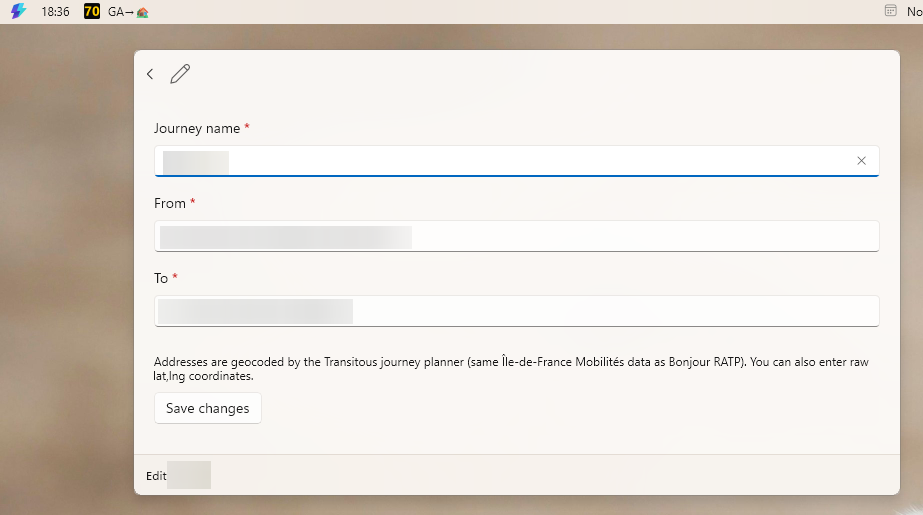

# RatpDock - SIEL (métro de paris) transit journeys time in the Command Palette Dock

A
[PowerToys Command Palette](https://learn.microsoft.com/windows/powertoys/command-palette/overview)
extension that shows **live public-transit journey times** between two saved
addresses (Paris / Île-de-France), rendered as mini **RATP SIEL waiting-time
boards**.

## Story behind it

I was mad because I left my work to wait 2 hours on the metro platform at
Châtelet - Les Halles because of a train failure on the RER B line. I could have
worked extra hours to get paid overtime instead. This small widget allow me now
to check the journey time between two destination in Ile de France with public
transport. I just check it before leaving my work, and if the time is a little
bit lower than average, I leave.

## Features

- **Journey calculator using the real Bonjour RATP backend**
- **RATP board display**: dock icons are rendered mimicking the SIEL "temps
  d'attente" boards.
- **5-minute refresh** by default.
- **Click opens the Bonjour RATP itinerary**.

## The display



Neat RATP SIEL !

## Install from the latest release

The MSIX is signed with a self-signed certificate, so Windows must trust the
certificate before the package can install. Run this one-liner in PowerShell:
it downloads the `.cer` file from the release, imports it into
`LocalMachine\TrustedPeople` (accept the UAC prompt, admin is required for
that store), then installs the MSIX:

```powershell
Start-Process powershell -Verb RunAs -ArgumentList '-Command iwr https://github.com/maxerbox/powertoys-dock-ratp/releases/latest/download/RatpDock.cer -OutFile $env:TEMP\RatpDock.cer; Import-Certificate -FilePath $env:TEMP\RatpDock.cer -CertStoreLocation Cert:\LocalMachine\TrustedPeople; Add-AppxPackage "https://github.com/maxerbox/powertoys-dock-ratp/releases/latest/download/RatpDock_1.0.0.0_x64.msix"'
```

If the certificate is already trusted, install directly with:

```powershell
Add-AppxPackage "https://github.com/maxerbox/powertoys-dock-ratp/releases/latest/download/RatpDock_1.0.0.0_x64.msix"
```

Then open Command Palette, run **Reload**, and pin the `RatpDock Journeys` page
from the context menu to show it in the dock.

## Building & installing

Requires the .NET 10 SDK and the Windows SDK 10.0.26100 (install it from
Visual Studio Installer or the standalone SDK installer).

```powershell
dotnet publish RatpDock\RatpDock.csproj -c Release -r win-x64 -p:Platform=x64 `
  -p:GenerateAppxPackageOnBuild=true -p:AppxPackageDir=..\AppxPackages -p:AppxBundle=Never
```

Then sign and sideload the MSIX from `AppxPackages` (the manifest Publisher must
match a locally-trusted dev certificate - trust your cert once in
`LocalMachine\TrustedPeople`, or edit the Publisher to your own cert):

```powershell
signtool sign /fd SHA256 /sha1 <cert-thumbprint> <msix>
Add-AppxPackage <msix>
```

## Layout

```
RatpDock/
  Program.cs, RatpDockExtension.cs, RatpDockCommandsProvider.cs  # COM server + provider
  Models/RatpModels.cs          # SavedRoute, TransitLeg, JourneyStatus
  Helpers/RoutesStore.cs        # %USERPROFILE%\.ratpdock\routes.json
  Helpers/SettingsManager.cs    # refresh rate, click behavior
  Services/BonjourRatpClient.cs # primary: real Bonjour RATP BFF (WinHttpHandler/HTTP2)
  Services/TransitousClient.cs  # fallback: geocode + journey planning (keyless)
  Services/JourneyService.cs    # 5-minute polling + BFF→Transitous fallback
  Services/RatpDisplayRenderer.cs # GDI+ RATP board bitmaps
  Pages/JourneyPage.cs          # palette page
  Pages/JourneyDockPage.cs      # dock band
  Pages/RoutesPage.cs           # manage page
  Pages/RouteFormPage.cs        # add/edit form
```
